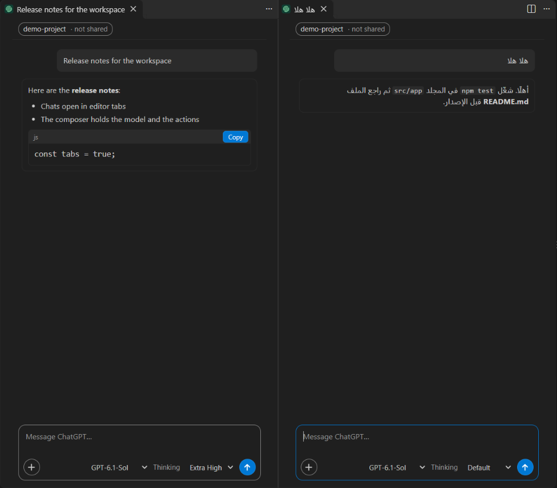

<p align="center">
  
</p>

<h1 align="center">Kenlith</h1>

<p align="center">
  <strong>ChatGPT inside your editor, with project context and controlled local actions.</strong>
</p>

<p align="center">
  <a href="https://github.com/MWForgeEG/Kenlith/releases/latest">Download the latest release</a> ·
  <a href="docs/USER-GUIDE.md">User guide</a> ·
  <a href="docs/SECURITY-MODEL.md">Security model</a> ·
  <a href="CHANGELOG.md">Changelog</a>
</p>

Kenlith is an open-source extension for **VS Code** and **Antigravity IDE**.
It lets you talk to ChatGPT about the project you have open, in an editor tab
next to your code. You sign in with your ChatGPT account. Kenlith needs no
OpenAI API key.

Kenlith is built for developers who want ChatGPT's help with a real codebase
and want to stay in control. Kenlith reads your files locally and decides, in
its own code, what may leave your machine: only excerpts and results you have
allowed are sent. Every file change is shown to you
before it is applied, and commands that could change anything wait for your
approval.



> Kenlith is an independent open-source project. It is not affiliated with or
> endorsed by OpenAI, Microsoft, Google, Anthropic, or the VS Code project.

## What Kenlith does

- **Sign in with ChatGPT.** Kenlith uses OpenAI's official Sign in with
  ChatGPT flow for open-source apps. No API key. Messages count toward your
  ChatGPT plan's usage. Kenlith itself is free.
- **Chats in editor tabs.** Each chat opens in its own tab, can sit beside your
  code, and comes back after a restart. The side bar lists your chats by
  project, with groups and search.
- **Project awareness, within limits.** In a project chat, Kenlith picks short
  excerpts from the files that match your question. There are fixed limits on
  file count, file size, total size and excerpt count.
- **Project tools.** ChatGPT can ask Kenlith for more evidence with read-only
  tools: a project summary, folder listings, file search, text search, reading
  up to 200 lines of a file, and the names of your open files.
- **Per-project sharing control.** Nothing from a project is sent until you
  allow it for that project and that ChatGPT account. You can stop sharing at
  any time.
- **Review Before Apply.** ChatGPT can propose edits to existing text files.
  You see the diff. Only **Apply** writes, and it writes into the editor
  without saving, so you can still undo.
- **Controlled command execution.** ChatGPT can ask to run a program or a
  workspace task. Kenlith classifies every run itself:
  - safe local checks, such as tests, linters and `git status`, run without a
    prompt;
  - anything with side effects waits for your one-time approval;
  - dangerous runs are refused.
- **Secret and output protection.** Credential files are never read or sent.
  Known secret formats and the values of your secret files are removed from
  command output before anything leaves your machine (see
  [limitations](#current-limitations)).
- **Model selection** per chat.
- **Thinking Effort** per chat: **Default**, **Low**, **Medium**, **High**,
  **Extra High** or **Max**. Default lets the model use its own level.
- **Arabic and right-to-left text** in messages, replies and the composer.
- **Persistent local conversations.** Chats and unsent drafts are saved on
  your computer, separate from chatgpt.com.

## Why Kenlith

Kenlith supports this way of working:

**Understand → Discuss → Review → Apply → Test**

1. **Understand.** Ask about the project. Kenlith gives ChatGPT bounded,
   relevant excerpts and read-only tools.
2. **Discuss.** Work through the problem in a chat that remembers its project,
   model and Thinking level.
3. **Review.** Proposed changes arrive as a diff you can inspect in the
   editor's own diff view.
4. **Apply.** Nothing changes until you press **Apply**, and only the exact
   diff you reviewed is written.
5. **Test.** ChatGPT can run your tests. Safe checks run directly, and
   anything riskier asks first.

Your project files stay under your control on your computer. Outbound project
data, such as excerpts, tool results and command output, follows Kenlith's
sharing and security boundaries. Those boundaries are enforced in Kenlith's
code, not by instructions to the model.

## Installation

Kenlith is distributed as a `.vsix` file through
[GitHub Releases](https://github.com/MWForgeEG/Kenlith/releases/latest). It is
not published on the VS Code Marketplace, Open VSX or any other extension
marketplace.

**Requirements:** VS Code 1.107 or later, or Antigravity IDE, and a ChatGPT
account on a plan that supports Sign in with ChatGPT. Kenlith has been tested
on Windows 11 (see [Current limitations](#current-limitations)).

1. Download `kenlith-antigravity-<version>.vsix` from the
   [latest release](https://github.com/MWForgeEG/Kenlith/releases/latest).
   Optionally, compare its SHA-256 with the value in the release notes.
2. In VS Code or Antigravity IDE, open the Command Palette (`Ctrl+Shift+P`)
   and run **Extensions: Install from VSIX...**. Select the downloaded file.
3. Open **Kenlith** from the Activity Bar.
4. Choose **Continue with ChatGPT** and finish signing in in your browser.
5. Open a project folder and start a new chat.

From a terminal:

```shell
# VS Code
code --install-extension kenlith-antigravity-0.8.0.vsix

# Antigravity IDE
antigravity-ide --install-extension kenlith-antigravity-0.8.0.vsix
```

The same `.vsix` works in both editors; `antigravity` in the file name and the
extension ID are historical. In the editor's extension list, Kenlith appears
with the extension ID `local-open-source.plan-chat-antigravity`.
Kenlith was named Plan Chat up to version 0.4.0. Version 0.4.1 changes the
product name only. The ID was kept so that upgrades keep your chats and
sign-in.

## Getting started

Open a project, start a chat, and try:

- `Explain the architecture of this project.`
- `Find the cause of these failing tests.`
- `Review the current Git diff.`
- `Propose the fix and show me the change before applying it.`
- `Run the relevant tests.`
- `Create a complete handoff instruction for Claude Code to continue this task.`

The first time a chat wants to send something from the project, Kenlith shows
what it would send and asks you to allow sharing for that project. The
[user guide](docs/USER-GUIDE.md) explains each feature in detail.

## Security model

In short (details in [docs/SECURITY-MODEL.md](docs/SECURITY-MODEL.md)):

- **Local project awareness.** Kenlith reads project files only when you send
  a message in that project's chat, only inside the open project folder, and
  only in a trusted workspace. It never follows symbolic links or Windows
  junctions.
- **Explicit sharing grant.** Nothing from a project is sent to OpenAI until
  you allow sharing for that project and ChatGPT account. You can stop at any
  time. Stopping cannot recall what was already sent.
- **Sensitive files are excluded.** Kenlith never reads or sends `.env` files,
  private keys, certificates, credential stores, folders such as `.ssh`,
  `.aws` or `.git` internals, or any file whose content looks like a password
  or key. No setting can turn this off. Your `files.exclude` and
  `search.exclude` settings can only exclude more.
- **Review Before Apply.** File changes are proposals until you press
  **Apply** on the exact diff. Allowing sharing never allows writing.
- **Commands by risk:**
  - *Safe checks run.* Tests, linters, type checks and read-only Git commands
    run without a prompt, but only in known, allow-listed forms. A test or
    build script runs your project's own code: Kenlith screens the script but
    cannot prove what it does.
  - *Changes wait for you.* Installs, network use, file or Git changes, shells
    and unknown programs show one approval card with the exact command. One
    approval covers one run, and there is no "always allow".
  - *Dangerous runs are refused.* This covers elevation, destructive or system
    commands, forced Git operations, credential access, paths outside the
    project, and remote or cloud tools.
- **Output filtering.** Before command output is sent, Kenlith removes
  credential-like text, private keys, values from your secret files, long
  random-looking strings and paths outside the project.
- **Workspace Trust.** Kenlith does not run in Restricted Mode (a folder you
  have not marked as trusted in the editor).
- **Not a sandbox.** Commands that Kenlith runs are ordinary processes on
  your computer. Kenlith limits *which* commands run and *what is sent*, but
  it does not provide an operating-system sandbox.

To report a vulnerability, see [SECURITY.md](SECURITY.md).

## Current limitations

- **Platform.** Tested on Windows 11 with VS Code 1.143 and Antigravity
  IDE 1.107. Linux, macOS and remote windows (SSH, WSL, containers) have not
  been verified.
- **Detached processes.** **Stop** and the time limit end a command and the
  processes it started. A program that detaches itself, such as a background
  server, can keep running.
- **Secret detection has limits.** Kenlith removes known credential formats
  and values from your secret files, including common encodings. It cannot
  detect every transformed or reworded secret.
- **Thinking levels come from a static table.** Kenlith offers Thinking
  levels only for models in its built-in list, which follows OpenAI's model
  documentation. Other models offer Default only. Thinking Effort has been
  verified live on `gpt-6.1-sol` only.
- **Screen readers.** The interface has named controls, keyboard navigation
  and visible focus, but it has not been validated with a screen reader.
- **No marketplace install.** Kenlith is installed from a `.vsix` file only.
- **Server-side sign-out not independently verified.** Sign Out removes
  local tokens and asks OpenAI to revoke the session. To be certain, also
  disconnect the app in your ChatGPT settings.

## Building and testing

Kenlith uses only Node.js built-ins and the VS Code extension API. There are
no npm dependencies to install. Development has been verified with Node.js 24.

```shell
git clone https://github.com/MWForgeEG/Kenlith.git
cd Kenlith
npm test            # unit and cross-process tests (node --test)
npm run package     # builds dist/plan-chat-antigravity-<version>.vsix
```

To build a release-named file reproducibly, set `SOURCE_DATE_EPOCH` and choose
the file name:

```powershell
$env:SOURCE_DATE_EPOCH = "1767225600"
node scripts/package-vsix.js --out dist --artifact kenlith-antigravity
```

The editor integration suites start an isolated editor with a throwaway
profile. They never touch your installed extension or your real profile:

```powershell
node test/integration/run.js "$env:LOCALAPPDATA\Programs\Microsoft VS Code\Code.exe"
node test/integration/run.js "$env:LOCALAPPDATA\Programs\Antigravity IDE\Antigravity IDE.exe"
```

A few downgrade-compatibility tests need historical release packages that are
not part of this repository. Those tests are reported as skipped.

## Contributing

Bug reports, ideas and pull requests are welcome. See
[CONTRIBUTING.md](CONTRIBUTING.md). Please follow the
[Code of Conduct](CODE_OF_CONDUCT.md).

- **Bugs and feature requests:** [GitHub Issues](https://github.com/MWForgeEG/Kenlith/issues)
- **Security vulnerabilities:** never in a public issue. See [SECURITY.md](SECURITY.md).

The public source history of this repository begins with Kenlith 0.8.0.

## License

Kenlith is released under the [MIT License](LICENSE).

## Disclaimer

Kenlith is an independent open-source project. It is not affiliated with or
endorsed by OpenAI, Microsoft, Google, Anthropic, or the VS Code project.
ChatGPT is a trademark of OpenAI. VS Code and Visual Studio Code are
trademarks of Microsoft. Product names are used only to describe
compatibility.
